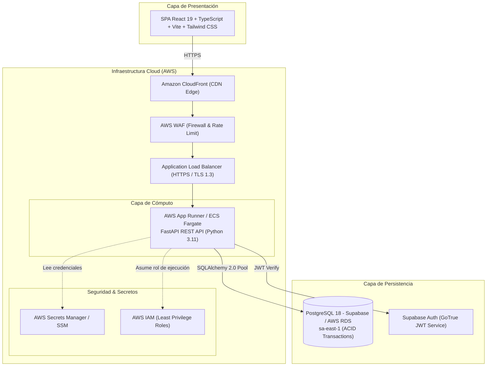
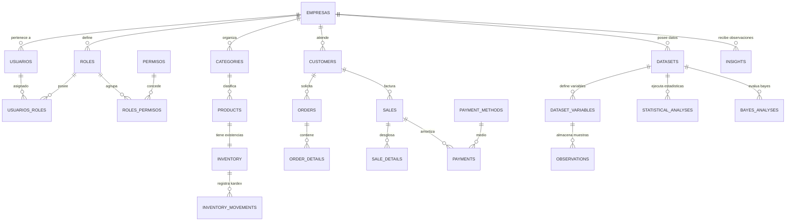

# 🛡️ SalesIA Enterprise — Servicio de Seguridad y Gestión Empresarial en AWS

[](https://aws.amazon.com/)
[](https://fastapi.tiangolo.com/)
[](https://www.postgresql.org/)
[](https://react.dev/)
[](https://tailwindcss.com/)
[](#)

> **SalesIA Enterprise** es una plataforma web empresarial de nivel corporativo orientada a la **gestión integral del ciclo comercial**, **control de inventario con trazabilidad estricta (Kardex)**, **arquitectura de seguridad multi-tenant con control de acceso basado en roles (RBAC)** y un **motor analítico-estadístico y probabilístico determinístico** (Semana 07: Estadígrafos muestrales, Teorema de Bayes e inferencia de datos).
> 
> Diseñada siguiendo principios de **Arquitectura Limpia (DDD)** y un **Monolito Modular**, preparada para su despliegue seguro y de alta disponibilidad en **Amazon Web Services (AWS)** y **Supabase**.

---

## 📑 Tabla de Contenidos

1. [Visión General y Objetivos](#-visión-general-y-objetivos)
2. [Arquitectura del Sistema](#-arquitectura-del-sistema)
3. [Avances Realizados y Cronología](#-avances-realizados-y-cronología)
4. [Estructura y Datos de la Base de Datos](#-estructura-y-datos-de-la-base-de-datos)
   - [Esquema de Tablas por Dominio](#esquema-de-tablas-por-dominio)
   - [Matriz de Roles y Catálogo de Permisos (RBAC)](#matriz-de-roles-y-catálogo-de-permisos-rbac)
   - [Datos Semilla y Población Inicial (Seed Data)](#datos-semilla-y-población-inicial-seed-data)
5. [Estrategia y Guía de Despliegue en AWS](#-estrategia-y-guía-de-despliegue-en-aws)
   - [Topología en la Nube](#topología-en-la-nube)
   - [Seguridad en AWS (Cloud Security)](#seguridad-en-aws-cloud-security)
   - [Guía de Despliegue Paso a Paso](#guía-de-despliegue-paso-a-paso)
6. [Instalación y Ejecución Local](#-instalación-y-ejecución-local)
7. [Suite de Pruebas Automatizadas](#-suite-de-pruebas-automatizadas)
8. [Estructura del Repositorio](#-estructura-del-repositorio)

---

## 🎯 Visión General y Objetivos

El proyecto unifica las operaciones comerciales de una empresa con el rigor matemático y estadístico:

* **Gestión Comercial Completa:** Administración de clientes (personas naturales y jurídicas), productos, categorías, inventario multi-almacén, cotizaciones, órdenes con reserva de stock, ventas con snapshot histórico inmutable y amortización de pagos con múltiples métodos.
* **Control de Existencias Transaccional:** Bloqueo de concurrencia a nivel de fila (`SELECT ... FOR UPDATE`), garantizando que jamás existan inventarios negativos ni inconsistencias durante ventas simultáneas.
* **Seguridad y Multi-Tenant:** Aislamiento estricto por empresa (`company_id`), integración de identidad 1:1 con **Supabase Auth (GoTrue JWT)** y matriz RBAC con 20 permisos granulares.
* **Motor Estadístico Determinístico (Semana 07):**
  * Medidas de tendencia central: Media aritmética ($\bar{x} = \frac{1}{n} \sum x_i$) y Mediana (ordenamiento muestral para $n$ par e impar).
  * Evaluación de asimetría y dispersión muestral sin conclusiones sesgadas.
  * Inferencia probabilística formal mediante el **Teorema de Bayes** ($P(A|B) = \frac{P(B|A) \cdot P(A)}{P(B)}$) con validación de coherencia axiomática de Kolmogorov y paso a paso algebraico explicable.
  * Generación de alertas automáticas (Insights) y reportes ejecutivos en PDF/CSV.

---

## 🏗️ Arquitectura del Sistema

El sistema implementa un **Monolito Modular** desacoplado por contextos delimitados (Bounded Contexts):



---

## 🚀 Avances Realizados y Cronología

A lo largo de las iteraciones de desarrollo se completaron los siguientes hitos:

### 1. Fase 01 — Levantamiento de Requisitos y Reglas de Negocio
* Se definieron los 5 roles clave del sistema (**Administrador, Gerente Comercial, Vendedor, Almacén, Analista de Datos**).
* Se establecieron reglas de negocio fundamentales:
  * **RN-CLI-01 / RN-CLI-03:** Documentación fiscal única por empresa (RUC, DNI, Pasaporte) y proyección en caliente de indicadores de compra desde `sales`.
  * **RN-PRO-02 / RN-PRO-05:** Inmutabilidad en ventas históricas frente a modificaciones en catálogo; fórmulas de margen neto unitario y porcentual protegidas contra divisiones por cero.
  * **RN-INV-02 / RN-INV-03:** Cálculo de stock disponible ($\text{Físico} - \text{Reservado}$) y bloqueo transaccional.
  * **RN-PED-01 / RN-VEN-02:** Flujo de pedido a venta directa con conversión atómica de reserva a salida definitiva de stock.
* Documento oficial: [`docs/FASE_01_REQUISITOS_Y_REGLAS.md`](file:///c:/Users/usuario/OneDrive/Documentos/GitHub/Proyecto_Seguridad_AWS/docs/FASE_01_REQUISITOS_Y_REGLAS.md).

### 2. Fase 02 — Arquitectura Técnica y Contratos API
* Diseño de la topología técnica y definición de los contratos REST con prefijo `/api/v1` para más de 25 endpoints.
* Modelado de esquemas JSON con validación estricta de tipos de datos en Pydantic v2.
* Documento oficial: [`docs/FASE_02_ARQUITECTURA_Y_CONTRATOS.md`](file:///c:/Users/usuario/OneDrive/Documentos/GitHub/Proyecto_Seguridad_AWS/docs/FASE_02_ARQUITECTURA_Y_CONTRATOS.md).

### 3. Etapa 01 — Sistema de Autenticación y Control de Acceso por Roles (RBAC)
* **Integración con Supabase Auth (GoTrue):** Delegación completa de credenciales y hashing de contraseñas a Supabase Auth. Las contraseñas jamás se almacenan en tablas de la aplicación.
* **Formulario de Inicio de Sesión de Dos Pasos:**
  * **Paso 1 (Correo Electrónico):** Validación sintáctica estricta y protección contra enumeración de cuentas (nunca revela la existencia o inexistencia de un usuario).
  * **Paso 2 (Contraseña):** Autenticación criptográfica con toggle de visibilidad, mensajes de error genéricos y opción de recuperación de contraseña.
* **Flujo Post-Login Empresarial:**
  1. Obtención de token JWT desde Supabase Auth.
  2. Validación y decodificación criptográfica del token en FastAPI.
  3. Búsqueda y vinculación del usuario mediante su identificador único `auth.users.id` (UUID).
  4. Verificación de estado de cuenta (`activo == true`).
  5. Consulta y carga dinámica de la matriz de roles y permisos granulares.
  6. Redirección condicionada al dashboard correspondiente o pantalla de solicitud pendiente.
* **Registro de Cuentas y Aprobación Idempotente:**
  * Registro de colaboradores mediante Supabase Auth con confirmación de correo.
  * Inserción idempotente en `solicitudes_acceso` (estado `PENDIENTE`), bloqueando acceso a cualquier módulo corporativo hasta aprobación por un administrador.
  * Los usuarios regulares no pueden auto-asignarse el rol `ADMINISTRADOR`.
* **Gobernanza Administrativa de Solicitudes:** Módulo en Configuración (`SettingsPage.tsx`) que permite a los administradores autorizar o rechazar solicitudes, asignando uno o múltiples roles empresariales simultáneos (`GERENTE`, `VENDEDOR`, `ANALISTA`, `ALMACEN`, `ADMINISTRADOR`).
* **Procedimiento Seguro de Primer Administrador:** Script CLI auditado [`backend/bootstrap_admin.py`](file:///c:/Users/usuario/OneDrive/Documentos/GitHub/Proyecto_Seguridad_AWS/backend/bootstrap_admin.py) para inicializar al administrador principal con salvaguardas de concurrencia e inmutabilidad.
* **Estandarización al español** en entidades y servicios (`empresas`, `usuarios`, `roles`, `permisos`, `usuarios_roles`, `roles_permisos`, `solicitudes_acceso`).
* **Guardias de autorización RBAC:** Dependencia FastAPI `requerir_permiso("codigo:permiso")` para verificar permisos granulares en cada operación HTTP.
* **Salvaguarda de Administradores:** Regla que bloquea la desactivación o revocación del último usuario administrador del sistema.

### 4. Motor Estadístico y Probabilístico (Semana 07)
* Módulo matemático autónomo en [`backend/app/statistics/engine.py`](file:///c:/Users/usuario/OneDrive/Documentos/GitHub/Proyecto_Seguridad_AWS/backend/app/statistics/engine.py).
* Implementación de media aritmética, mediana (impar y par con interpolación de valores centrales) y análisis de asimetría muestral.
* Motor probabilístico formal para el Teorema de Bayes con validación de denominadores distintos de cero y coherencia axiomática ($P(B|A) \cdot P(A) \le P(B)$).

### 5. Frontend Empresarial Completo
* Aplicación SPA desarrollada con **React 19, TypeScript, Vite, Tailwind CSS y Lucide Icons**.
* Vistas interactivas implementadas:
  * **Dashboard:** Resumen de KPIs en tiempo real (Ingresos netos, pedidos por confirmar, alertas de existencias críticas).
  * **Clientes:** Listado con búsqueda, alta modal y fichas con historial de compras.
  * **Catálogo & Productos:** Gestión de inventario inicial, margen bruto dinámico y alertas mínimas.
  * **Inventario & Kardex:** Monitor de existencias (físicas, reservadas, disponibles) y registro de movimientos (Entrada, Salida, Ajuste).
  * **Pedidos & Ventas:** Punto de emisión, anulación con reposición física de existencias y comprobantes.
  * **Pagos & Amortizaciones:** Control de saldos y medios de cobro.
  * **Analítica & Probabilidad:** Evaluador interactivo de fórmulas estadísticas y Teorema de Bayes.
  * **Reportes:** Exportación consolidada en formatos descargables.

---

## 🗄️ Estructura y Datos de la Base de Datos

### Esquema de Tablas por Dominio

El modelo de datos se organiza en 3 capas lógicas:



---

### Matriz de Roles y Catálogo de Permisos (RBAC)

El sistema cuenta con **5 roles empresariales** predefinidos y **20 permisos granulares**:

| Código de Rol | Nombre del Rol | Alcance y Responsabilidades |
| :--- | :--- | :--- |
| `ADMINISTRADOR` | Administrador General | Control total del sistema, configuración institucional, usuarios, auditoría y roles. |
| `GERENTE` | Gerente Comercial | Supervisión ejecutiva, metas de vendedores, reportes consolidados y dashboards globales. |
| `VENDEDOR` | Ejecutivo Comercial | Registro de pedidos, cotizaciones, ventas directas y consulta de sus KPIs personales. |
| `ALMACEN` | Encargado de Almacén | Control de existencias físicas, registro de entradas, salidas y ajustes de inventario. |
| `ANALISTA` | Analista de Datos / BI | Exploración analítica, modelado de variables, Teorema de Bayes y exportación de reportes. |

#### Catálogo Oficial de los 20 Permisos del Sistema

| Módulo | Código de Permiso | Nombre | Descripción |
| :--- | :--- | :--- | :--- |
| **Empresas** | `empresas:configurar` | Configurar Empresa | Modificar datos fiscales, dirección e impuestos de la empresa. |
| **Usuarios** | `usuarios:administrar` | Administrar Usuarios | Crear, editar y asignar roles a los colaboradores del sistema. |
| **Roles** | `roles:administrar` | Administrar Roles | Gestionar los roles y la asignación de permisos del sistema. |
| **Clientes** | `clientes:leer` | Consultar Clientes | Visualizar el listado y las fichas comerciales de clientes. |
| **Clientes** | `clientes:escribir` | Registrar Clientes | Crear y actualizar información de contacto y fiscal de clientes. |
| **Productos** | `productos:leer` | Consultar Catálogo | Visualizar productos, precios de venta y márgenes comerciales. |
| **Productos** | `productos:administrar` | Gestionar Catálogo | Crear, editar y dar de baja productos y categorías del catálogo. |
| **Inventario** | `inventario:leer` | Consultar Existencias | Consultar stock físico, reservado y disponible con alertas mínimas. |
| **Inventario** | `inventario:ajustar` | Ajustar Inventario | Registrar entradas, salidas y ajustes manuales en el Kardex. |
| **Pedidos** | `pedidos:crear` | Crear Pedidos | Registrar pedidos comerciales y cotizaciones con detalle. |
| **Pedidos** | `pedidos:confirmar` | Confirmar Pedidos | Confirmar pedidos en firme y generar reservas de existencias. |
| **Ventas** | `ventas:crear` | Emitir Ventas | Registrar ventas directas o confirmar ventas desde pedidos. |
| **Ventas** | `ventas:anular` | Anular Ventas | Autorizar la anulación de ventas con reposición física de existencias. |
| **Pagos** | `pagos:registrar` | Registrar Cobros | Registrar cobros y amortizaciones con métodos de pago autorizados. |
| **Personal** | `personal:administrar` | Gestionar Vendedores | Administrar metas mensuales y porcentajes de comisión de vendedores. |
| **Analytics** | `analytics:ver` | Ver Analítica | Consultar paneles de métricas estadísticas y evolución temporal. |
| **Probabilidades** | `probabilidad:calcular` | Calcular Probabilidades | Ejecutar análisis del Teorema de Bayes y variables discretas. |
| **Insights** | `insights:ver` | Ver Insights | Visualizar observaciones automáticas generadas por reglas cuantitativas. |
| **Reportes** | `reportes:exportar` | Exportar Reportes | Generar y descargar reportes comerciales en formato CSV y PDF. |
| **Auditoría** | `auditoria:consultar` | Ver Auditoría | Consultar bitácora de eventos sensibles y registros de seguridad. |

---

### Datos Semilla y Población Inicial (Seed Data)

El script [`backend/seed_data.py`](file:///c:/Users/usuario/OneDrive/Documentos/GitHub/Proyecto_Seguridad_AWS/backend/seed_data.py) puebla la base de datos con un entorno corporativo completamente funcional:

#### 1. Datos Institucionales de la Empresa
* **Razón Social:** `SalesIA Tech Solutions S.A.C.`
* **Identificador Fiscal (RUC):** `20608912345`
* **Dirección:** Av. República de Panamá 3505, San Isidro, Lima, Perú
* **Moneda Base:** USD ($)
* **Tasa Impositiva:** `18.00%` (IGV / IVA)

#### 2. Cuentas de Acceso Preconfiguradas (Entorno de Desarrollo)
| Correo Electrónico | Contraseña por Defecto | Nombre del Colaborador | Rol Asignado |
| :--- | :--- | :--- | :--- |
| `admin@salesia.com` | `admin123` | Administrador General | `ADMINISTRADOR` |
| `gerente@salesia.com` | `gerente123` | Valeria Quispe | `GERENTE` |
| `vendedor@salesia.com` | `vendedor123` | Carlos Mendoza | `VENDEDOR` |
| `analista@salesia.com` | `analista123` | Laura Gómez | `ANALISTA` |
| `almacen@salesia.com` | `almacen123` | Jorge Morales | `ALMACEN` |

#### 3. Catálogo de Productos y Existencias Iniciales
| SKU | Nombre del Producto | Categoría | Costo Unitario | Precio Venta | Stock Inicial | Alerta Mín. |
| :--- | :--- | :--- | :--- | :--- | :--- | :--- |
| `LAP-001` | ThinkPad Pro X1 Intel i7 32GB | Laptops & Cómputo | $950.00 | $1,450.00 | 25 | 5 |
| `LAP-002` | Dell Latitude 5440 Core i5 16GB | Laptops & Cómputo | $650.00 | $990.00 | 40 | 8 |
| `MON-001` | Monitor Dell Ultrasharp 27' 4K UHD | Monitores & Displays | $320.00 | $520.00 | 30 | 6 |
| `MON-002` | Monitor LG UltraWide 34' Curved | Monitores & Displays | $410.00 | $680.00 | 15 | 4 |
| `PER-001` | Logitech MX Master 3S Inalámbrico | Periféricos & Audio | $65.00 | $119.00 | 60 | 10 |
| `PER-002` | Teclado Mecánico Keychron K2 Pro | Periféricos & Audio | $75.00 | $135.00 | 35 | 8 |
| `RED-001` | Router Cisco Catalyst Wi-Fi 6 AX | Redes & Conectividad | $180.00 | $295.00 | 20 | 5 |
| `RED-002` | Switch Gigabit PoE+ Ubiquiti 24P | Redes & Conectividad | $240.00 | $390.00 | 12 | 3 |

#### 4. Clientes de Prueba
| Tipo | Razón Social / Nombre Completo | Tipo Doc. | N° Documento | Correo de Contacto |
| :--- | :--- | :--- | :--- | :--- |
| Jurídica | Corporación Minera del Sur S.A.C. | RUC | `20556781234` | compras@mineradelSur.com |
| Jurídica | InnovaTech Consulting Global S.A. | RUC | `20448912301` | it@innovatech.io |
| Natural | Mariana Rodríguez Silva | DNI | `47812904` | m.rodriguez@gmail.com |
| Natural | Roberto Palacios Benítez | DNI | `43198421` | r.palacios@hotmail.com |
| Jurídica | Logística & Transporte Andino S.A. | RUC | `20339841288` | operaciones@andino.com.pe |

---

## ☁️ Estrategia y Guía de Despliegue en AWS

### Topología en la Nube

El despliegue está optimizado para la nube de **Amazon Web Services (AWS)** con alta seguridad y bajo costo operativo:

1. **Frontend:** Alojado en **Amazon S3** como sitio estático y distribuido globalmente mediante **Amazon CloudFront** con compresión Brotli/Gzip, políticas de caché Edge y certificado SSL administrado por **AWS Certificate Manager (ACM)**.
2. **Backend:** Desplegado mediante contenedor Docker en **AWS App Runner** o **Amazon ECS Fargate** (Serverless Containers). Ambas opciones brindan autoescalado horizontal automático, balanceo de carga integrado y cero mantenimiento de servidores.
3. **Base de Datos:** **Supabase PostgreSQL** alojado en la región **AWS São Paulo (`sa-east-1`)** o **Amazon RDS PostgreSQL 18** en Multi-AZ con cifrado en reposo (AWS KMS).
4. **Secretos y Configuración:** Almacenados de forma centralizada en **AWS Secrets Manager** o **AWS Systems Manager Parameter Store**.

---

### Seguridad en AWS (Cloud Security)

Para garantizar la seguridad de la información conforme a las mejores prácticas del **AWS Well-Architected Framework (Pilar de Seguridad)**:

* **AWS WAF (Web Application Firewall):**
  * Reglas gestionadas por AWS contra ataques comunes (`AWSManagedRulesCommonRuleSet`).
  * Protección contra inyecciones SQL (`AWSManagedRulesSQLiRuleSet`).
  * Rate limiting por IP (máximo 1,000 peticiones en 5 minutos para frenar ataques DDoS / Brute Force).
* **Cifrado de Extremo a Extremo:**
  * En tránsito: Tráfico exclusivamente HTTPS / TLS 1.3 forzado mediante cabeceras HSTS.
  * En reposo: Cifrado mediante **AWS KMS** (`aws/rds` y `aws/s3`) con claves maestras gestionadas por el cliente.
* **Seguridad de Red (VPC & Security Groups):**
  * La base de datos reside en una subred privada sin acceso a Internet público.
  * Los Security Groups permiten tráfico al puerto PostgreSQL únicamente desde las IPs / VPC del backend de FastAPI.
* **Políticas IAM de Mínimo Privilegio:**
  * La tarea ECS / App Runner solo posee permisos de lectura para su secreto específico en AWS Secrets Manager y CloudWatch Logs.

---

### Guía de Despliegue Paso a Paso

#### Paso 1: Configurar la Base de Datos en Supabase / AWS RDS
1. Cree un proyecto en **Supabase** (Región: `sa-east-1 So Paulo`) o una instancia de **Amazon RDS PostgreSQL**.
2. Obtenga las cadenas de conexión:
   * **Conexión en Pool (para FastAPI):** Puerto `6543` (Transaction mode).
   * **Conexión Directa (para Alembic y migraciones DDL):** Puerto `5432` (Session mode).
3. Ejecute el script DDL de la Etapa 01:
   ```bash
   psql "postgresql://postgres:[PASSWORD]@[HOST]:5432/postgres" -f docs/etapa01_modulo_administrativo.sql
   ```

#### Paso 2: Crear el Contenedor Docker del Backend
Cree un archivo `backend/Dockerfile`:
```dockerfile
FROM python:3.11-slim

WORKDIR /app

RUN apt-get update && apt-get install -y --no-install-recommends \
    build-essential libpq-dev && \
    rm -rf /var/lib/apt/lists/*

COPY requirements.txt .
RUN pip install --no-cache-dir -r requirements.txt

COPY . .

EXPOSE 8000

CMD ["uvicorn", "app.main:app", "--host", "0.0.0.0", "--port", "8000"]
```

#### Paso 3: Construir y Publicar la Imagen en Amazon ECR
```bash
# 1. Autenticarse en Amazon ECR
aws ecr get-login-password --region us-east-1 | docker login --username AWS --password-stdin <ACCOUNT_ID>.dkr.ecr.us-east-1.amazonaws.com

# 2. Crear repositorio en ECR
aws ecr create-repository --repository-name salesia-backend --region us-east-1

# 3. Construir y subir imagen
docker build -t salesia-backend ./backend
docker tag salesia-backend:latest <ACCOUNT_ID>.dkr.ecr.us-east-1.amazonaws.com/salesia-backend:latest
docker push <ACCOUNT_ID>.dkr.ecr.us-east-1.amazonaws.com/salesia-backend:latest
```

#### Paso 4: Desplegar el Backend en AWS App Runner
1. En la consola de AWS, diríjase a **AWS App Runner** > **Crear servicio**.
2. Seleccione el repositorio ECR `<ACCOUNT_ID>.dkr.ecr.us-east-1.amazonaws.com/salesia-backend:latest`.
3. Configure las variables de entorno asociadas a **AWS Secrets Manager**:
   * `DATABASE_URL`: Cadena de conexión transaccional de PostgreSQL.
   * `SUPABASE_JWT_SECRET`: Clave secreta del JWT de Supabase.
   * `SECRET_KEY`: Secreto criptográfico de la aplicación.
   * `BACKEND_CORS_ORIGINS`: Dominio público del Frontend en CloudFront (ej. `https://d123456789.cloudfront.net`).
4. Asigne el puerto de escucha: `8000`.

#### Paso 5: Compilar y Desplegar el Frontend en Amazon S3 + CloudFront
1. Configure la variable de entorno de producción en `frontend/.env.production`:
   ```env
   VITE_API_BASE_URL=https://<APP_RUNNER_ID>.us-east-1.awsapprunner.com/api/v1
   ```
2. Compile los artefactos optimizados:
   ```bash
   cd frontend
   npm run build
   ```
3. Sincronice los archivos compilados en el bucket S3:
   ```bash
   aws s3 sync dist/ s3://salesia-enterprise-frontend-prod --delete
   ```
4. Invalide la caché de CloudFront para reflejar el nuevo despliegue:
   ```bash
   aws cloudfront create-invalidation --distribution-id <DISTRIBUTION_ID> --paths "/*"
   ```

---

## 💻 Instalación y Ejecución Local

### ⚡ Modo Rápido (1-Clic para Todo el Proyecto)

Hemos creado scripts automatizados que comprueban la base de datos, inicializan el entorno virtual y arrancan tanto el Backend como el Frontend simultáneamente:

| Script / Comando | Descripción |
| :--- | :--- |
| **`iniciar_proyecto.bat`** | **Lanzador Maestro:** Inicia PostgreSQL, levanta el Backend (8000), el Frontend (5173) y abre el navegador automáticamente en `http://localhost:5173`. Doble clic en Windows o ejecutar en terminal. |
| **`.\iniciar_proyecto.ps1`** | Versión para **PowerShell** con comprobación de estado de salud y logs formateados. |
| **`iniciar_backend.bat`** | Inicia exclusivamente el servidor Backend FastAPI en puerto `8000`. |
| **`iniciar_frontend.bat`** | Inicia exclusivamente el servidor Frontend React/Vite en puerto `5173`. |
| **`detener_servicios.bat`** | Detiene y libera limpiamente los puertos `8000`, `5173` y `5433`. |
| **`npm run dev`** | Ejecuta el lanzador maestro desde la raíz del proyecto. |

---

### 🛠️ Modo Manual Paso a Paso

#### Requisitos Previos
* Python 3.11+
* Node.js 18+ y npm
* PostgreSQL 18 (en puerto `5433` o remoto en Supabase)

#### 1. Iniciar PostgreSQL Local (si aplica)
```bash
"C:\Program Files\PostgreSQL\18\bin\postgres.exe" -D "%USERPROFILE%\pg_salesia_data" -p 5433
```

#### 2. Configuración y Ejecución del Backend
```bash
# Acceder al directorio backend
cd backend

# Crear entorno virtual de Python
python -m venv venv

# Activar el entorno virtual
# En Windows (PowerShell):
.\venv\Scripts\Activate.ps1
# En Linux / Mac:
source venv/bin/activate

# Instalar dependencias
pip install -r requirements.txt

# Poblar base de datos inicial (Seed Data)
python seed_data.py

# Iniciar servidor de desarrollo FastAPI
uvicorn app.main:app --host 127.0.0.1 --port 8000 --reload
```
Documentación interactiva disponible en:
👉 `http://127.0.0.1:8000/api/v1/docs`

#### 3. Configuración y Ejecución del Frontend
```bash
# Acceder al directorio frontend
cd frontend

# Instalar dependencias
npm install

# Iniciar servidor de desarrollo Vite
npm run dev -- --host 127.0.0.1 --port 5173
```
Aplicación web disponible en:
👉 `http://127.0.0.1:5173`


---

## 🧪 Suite de Pruebas Automatizadas

El backend incluye una suite completa de pruebas unitarias y de integración desarrolladas con `pytest`:

```bash
# Ejecutar todas las pruebas del backend
pytest backend/tests -v
```

### Cobertura de Pruebas (21/21 Pruebas Aprobadas):
1. **Seguridad y Autenticación Supabase ([`test_seguridad_autenticacion.py`](file:///c:/Users/usuario/OneDrive/Documentos/GitHub/Proyecto_Seguridad_AWS/backend/tests/test_seguridad_autenticacion.py)):**
   * Verificación de correo con mitigación estricta de enumeración de cuentas (`200 OK` indistinto).
   * Validación criptográfica de tokens Supabase y rechazo con `401 Unauthorized` ante tokens espurios o manipulados.
   * Carga de sesión activa con resolución de UUID, roles activos y los 20 permisos granulares.
   * Ciclo completo de solicitud de acceso: Registro pendiente, bloqueo de módulos, aprobación por administrador con asignación de múltiples roles (`GERENTE`, `VENDEDOR`) y creación en `usuarios`.
2. **Control de Acceso RBAC ([`test_etapa01_administracion.py`](file:///c:/Users/usuario/OneDrive/Documentos/GitHub/Proyecto_Seguridad_AWS/backend/tests/test_etapa01_administracion.py)):**
   * Validación de recuperación de perfil y verificación de los 20 permisos para rol `ADMINISTRADOR`.
   * Consulta de datos institucionales de empresa.
   * Control de acceso estricto: Acceso autorizado con código `200 OK` para admin y denegación con `403 Forbidden` para vendedores sin permiso `usuarios:administrar`.
   * Catálogo de roles del sistema y permisos granulares.
3. **Motor Estadístico y Probabilidad ([`test_statistics.py`](file:///c:/Users/usuario/OneDrive/Documentos/GitHub/Proyecto_Seguridad_AWS/backend/tests/test_statistics.py)):**
   * Cálculo determinístico de media aritmética y manejo de muestras vacías (`ValueError`).
   * Mediana para tamaños de muestra impares y pares (interpolación).
   * Comparación de media vs mediana para detección prudente de asimetría.
   * Evaluación formal del **Teorema de Bayes** ($P(A|B)$) y validación de casos anómalos (división por cero y violación del axioma de probabilidad conjunta).
4. **Endpoints de API ([`test_api.py`](file:///c:/Users/usuario/OneDrive/Documentos/GitHub/Proyecto_Seguridad_AWS/backend/tests/test_api.py)):**
   * Healthcheck `/api/v1/health`.
   * Autenticación JWT y endpoint del Teorema de Bayes vía HTTP.

---

## 📁 Estructura del Repositorio

```
Proyecto_Seguridad_AWS/
├── README.md                           # Documentación principal del repositorio
├── docs/                               # Documentación arquitectónica y scripts SQL
│   ├── FASE_01_REQUISITOS_Y_REGLAS.md   # Levantamiento exhaustivo de reglas y requisitos
│   ├── FASE_02_ARQUITECTURA_Y_CONTRATOS.md # Especificación técnica y contratos API
│   └── etapa01_modulo_administrativo.sql# Script DDL de tablas administrativas y RBAC
├── backend/                            # Núcleo del Backend en FastAPI (Python)
│   ├── alembic/                        # Control de versiones de base de datos
│   ├── app/
│   │   ├── api/v1/                     # Controladores y endpoints REST (/api/v1)
│   │   │   ├── administracion.py       # Endpoints del módulo administrativo y RBAC
│   │   │   ├── auth.py                 # Autenticación y emisión de tokens
│   │   │   ├── customers.py            # Gestión comercial de clientes
│   │   │   ├── products.py             # Catálogo y cálculo de márgenes
│   │   │   ├── inventory.py            # Existencias y movimientos de almacén
│   │   │   ├── orders.py               # Órdenes y reserva de existencias
│   │   │   ├── sales.py                # Ventas y facturación inmutable
│   │   │   ├── payments.py             # Cobros y amortizaciones
│   │   │   ├── statistics.py           # Motor estadístico (media, mediana, variables)
│   │   │   └── dashboard.py            # KPIs ejecutivos en tiempo real
│   │   ├── infraestructura/            # Clientes externos (Supabase Auth / GoTrue)
│   │   ├── models/                     # Modelos ORM de SQLAlchemy 2.0
│   │   ├── modulos/                    # Subdominios modulares (DDD)
│   │   │   ├── empresas/               # Modelos, esquemas y servicios de empresas
│   │   │   ├── roles/                  # Gestión de roles y permisos RBAC
│   │   │   └── usuarios/               # Gestión de usuarios y cuentas
│   │   ├── nucleo/                     # Configuración central y pool de base de datos
│   │   └── statistics/                 # Motor matemático determinístico
│   ├── requirements.txt                # Dependencias de Python
│   ├── seed_data.py                    # Script de población de datos semilla
│   └── tests/                          # Suite de pruebas automatizadas con pytest
└── frontend/                           # Aplicación Web SPA (React + TypeScript + Vite)
    ├── package.json                    # Dependencias de Node.js
    ├── src/
    │   ├── layouts/                    # Layout principal con navegación lateral
    │   ├── modules/                    # Vistas modulares de negocio
    │   │   ├── analytics/              # Paneles de series temporales y KPIs
    │   │   ├── customers/              # Directorio y fichas de clientes
    │   │   ├── dashboard/              # Panel ejecutivo principal
    │   │   ├── inventory/              # Existencias y registro de movimientos Kardex
    │   │   ├── orders/                 # Emisión y confirmación de pedidos
    │   │   ├── payments/               # Registro y amortización de pagos
    │   │   ├── probability/            # Calculadora formal del Teorema de Bayes
    │   │   ├── products/               # Catálogo de productos y cálculo de márgenes
    │   │   └── sales/                  # Punto de venta, facturación y anulación
    │   ├── services/api.ts             # Cliente Axios con interceptores JWT
    │   └── types/                      # Interfaces TypeScript tipadas
    └── vite.config.ts                  # Configuración del bundler Vite
```

---

## 👥 Autores y Mantenimiento

* **Proyecto:** SalesIA Enterprise — Servicio de Seguridad en AWS
* **Estado:** Etapa 01 (Autenticación y RBAC con Supabase) completada satisfactoriamente con 21/21 pruebas automatizadas operacionales (100% de éxito).
